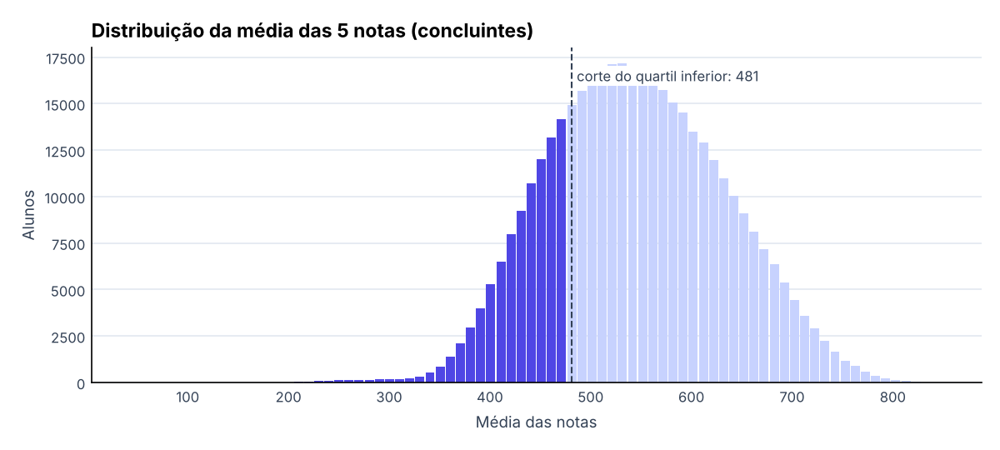
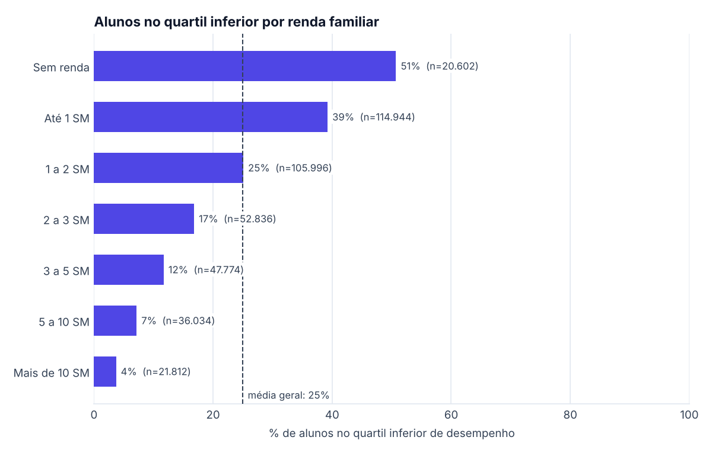
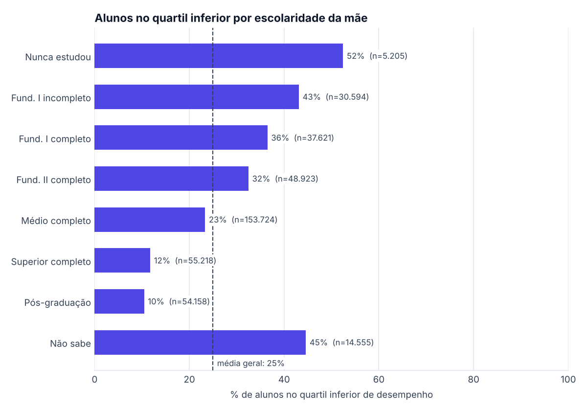
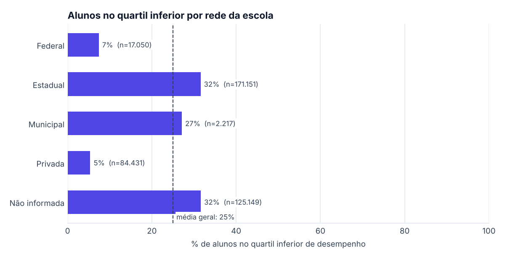
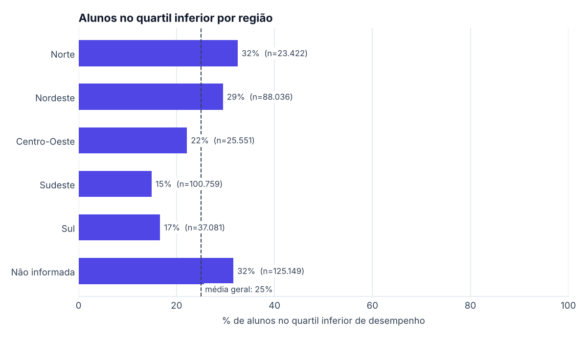
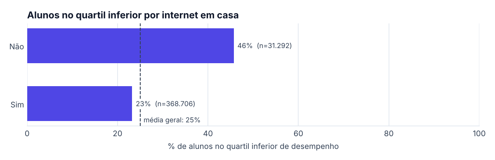
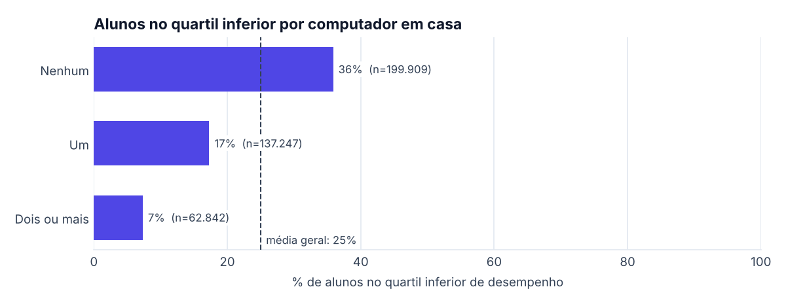
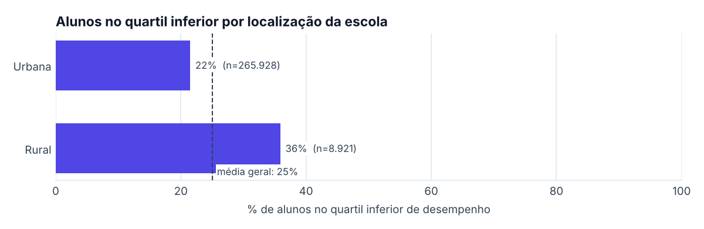

# Análise exploratória – ENEM 2023

- Amostra: 399.998 concluintes presentes nas 4 provas e com redação válida
- Média das 5 notas: 545.1 · corte do quartil inferior: **481.2**
- Taxa geral no quartil inferior: 25.0% (por definição, cerca de 25%)

Gerado por `python -m ml.eda`. SM = salário mínimo de 2023 (R$ 1.320).

## Renda familiar

| Renda familiar | Alunos | % no quartil inferior | Média das notas |
| --- | --- | --- | --- |
| Sem renda | 20.602 | 50.7% | 485.3 |
| Até 1 SM | 114.944 | 39.2% | 505.8 |
| 1 a 2 SM | 105.996 | 25.1% | 534.9 |
| 2 a 3 SM | 52.836 | 16.8% | 558.4 |
| 3 a 5 SM | 47.774 | 11.7% | 580.3 |
| 5 a 10 SM | 36.034 | 7.2% | 608.5 |
| Mais de 10 SM | 21.812 | 3.7% | 644.5 |

## Escolaridade da mãe

| Escolaridade da mãe | Alunos | % no quartil inferior | Média das notas |
| --- | --- | --- | --- |
| Nunca estudou | 5.205 | 52.4% | 481.7 |
| Fund. I incompleto | 30.594 | 43.1% | 498.6 |
| Fund. I completo | 37.621 | 36.5% | 511.5 |
| Fund. II completo | 48.923 | 32.5% | 520.1 |
| Médio completo | 153.724 | 23.3% | 542.9 |
| Superior completo | 55.218 | 11.7% | 587.6 |
| Pós-graduação | 54.158 | 10.4% | 598.8 |
| Não sabe | 14.555 | 44.6% | 498.5 |

## Rede da escola

| Rede da escola | Alunos | % no quartil inferior | Média das notas |
| --- | --- | --- | --- |
| Federal | 17.050 | 7.4% | 597.3 |
| Estadual | 171.151 | 31.6% | 521.3 |
| Municipal | 2.217 | 27.1% | 533.6 |
| Privada | 84.431 | 5.4% | 618.4 |
| Não informada | 125.149 | 31.6% | 521.2 |

## Região

| Região | Alunos | % no quartil inferior | Média das notas |
| --- | --- | --- | --- |
| Norte | 23.422 | 32.5% | 528.0 |
| Nordeste | 88.036 | 29.5% | 539.0 |
| Centro-Oeste | 25.551 | 22.1% | 555.0 |
| Sudeste | 100.759 | 14.9% | 574.3 |
| Sul | 37.081 | 16.7% | 564.7 |
| Não informada | 125.149 | 31.6% | 521.2 |

## Internet em casa

| Internet em casa | Alunos | % no quartil inferior | Média das notas |
| --- | --- | --- | --- |
| Não | 31.292 | 45.7% | 493.5 |
| Sim | 368.706 | 23.2% | 549.5 |

## Computador em casa

| Computador em casa | Alunos | % no quartil inferior | Média das notas |
| --- | --- | --- | --- |
| Nenhum | 199.909 | 35.9% | 512.6 |
| Um | 137.247 | 17.3% | 561.4 |
| Dois ou mais | 62.842 | 7.3% | 612.9 |

## Localização da escola

| Localização da escola | Alunos | % no quartil inferior | Média das notas |
| --- | --- | --- | --- |
| Urbana | 265.928 | 21.5% | 557.3 |
| Rural | 8.921 | 35.9% | 517.7 |

## Dados ausentes por variável

| Variável | % ausente |
| --- | --- |
| localizacao_escola | 31.3% |
| uf_escola | 31.3% |
| rede_escola | 31.3% |
| escolaridade_mae | 0.0% |
| escolaridade_pai | 0.0% |
| pessoas_residencia | 0.0% |
| ocupacao_mae | 0.0% |
| ocupacao_pai | 0.0% |
| renda_familiar | 0.0% |
| tipo_escola | 0.0% |
| internet | 0.0% |
| computador | 0.0% |
| faixa_etaria | 0.0% |

Observação: as variáveis da escola (rede, localização, UF) ficam vazias quando o aluno não informou a escola;
o modelo trata isso como a categoria “não informada”.
