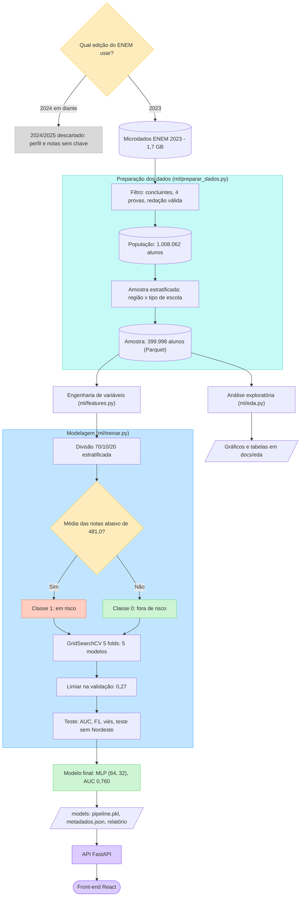
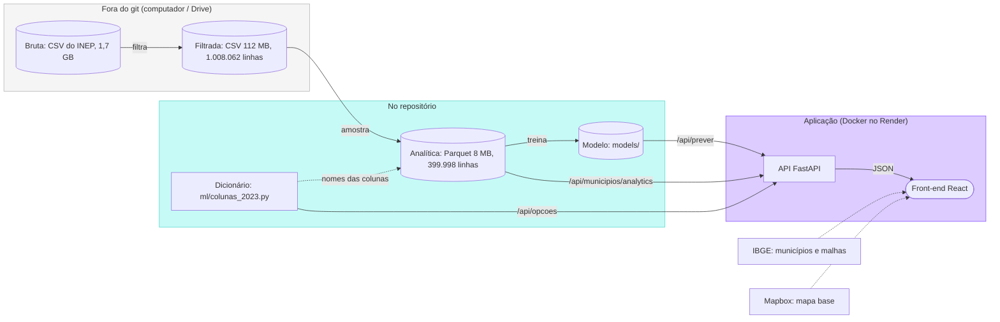

# Fluxogramas: análise de dados e base de dados

Os diagramas abaixo são escritos em [Mermaid](https://mermaid.js.org/) e o GitHub desenha sozinho.
Para alterar, edite o texto do bloco `mermaid` (dá para testar em <https://mermaid.live>).

## 1. Fluxo da análise de dados e do modelo

Do arquivo do INEP até o modelo usado pela aplicação. Números da execução registrada em `models/metadados.json`.

Regras que valem em todo o fluxo:

- O corte de 481,0 (quartil inferior) é calculado só no conjunto de ajuste, para não vazar informação do teste.
- As notas nunca entram como entrada do modelo: só formam o alvo.
- Cor/raça e sexo ficam fora do modelo e são usados só na análise de viés.

## 2. Estrutura da base de dados

O projeto não usa banco relacional: a base são arquivos em camadas, e a API lê a camada analítica.

- A API lê do Parquet só as colunas que usa e guarda textos como categorias: cerca de 30 MB em memória, dentro do limite de 512 MB do plano gratuito do Render.
- Os microdados do INEP são anônimos e as análises feitas na tela não são gravadas.
